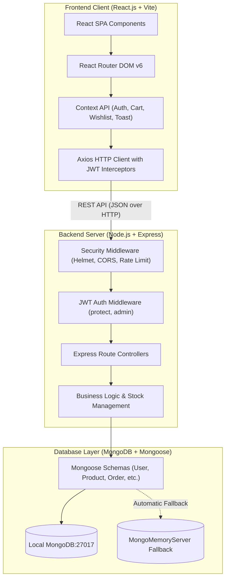
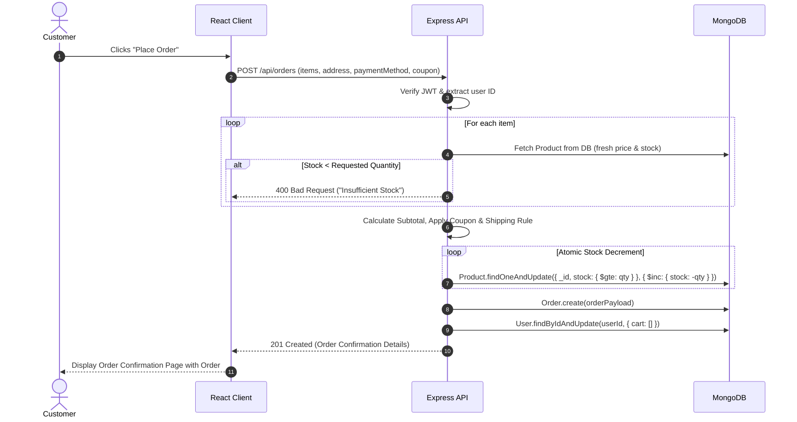
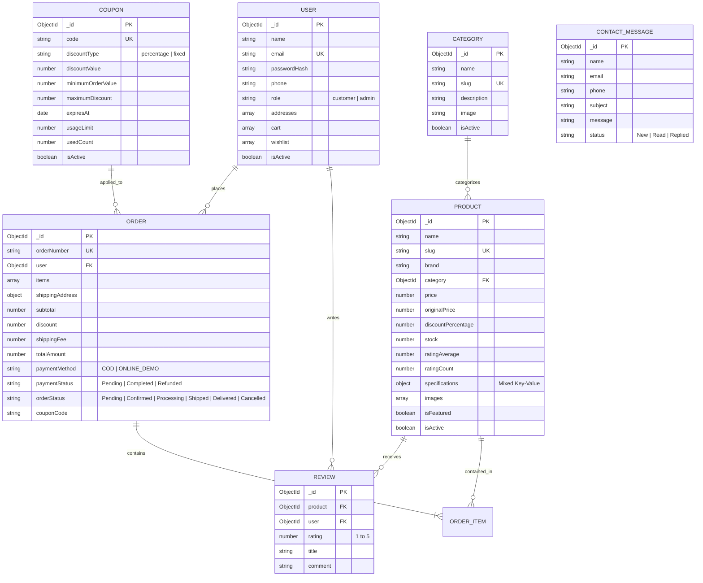

# ⚡ ElectroMart — Full-Stack Electronics E-Commerce Platform

> **"Technology That Fits Your Life"**  
> A production-ready, responsive, full-stack electronics e-commerce web application developed as a **College Mini-Project**. Built strictly using JavaScript (ES6+), React.js (Vite), Node.js, Express.js, and MongoDB (Mongoose ODM) with complete Indian Rupee (₹) localization.

---

## 📋 Table of Contents
1. [Project Abstract](#-project-abstract)
2. [Key Features](#-key-features)
3. [System Architecture](#-system-architecture)
4. [Technology Stack](#-technology-stack)
5. [Database Schema & ER Design](#-database-schema--er-design)
6. [Folder Structure](#-folder-structure)
7. [REST API Endpoints](#-rest-api-endpoints)
8. [Setup & Running Instructions](#-setup--running-instructions)
9. [Pre-Seeded Demo Credentials](#-pre-seeded-demo-credentials)
10. [Automated Test Suite](#-automated-test-suite)
11. [Viva & Project Defense Guide](#-viva--project-defense-guide)

---

## 💡 Project Abstract

**ElectroMart** is an online shopping platform designed exclusively for **consumer electronics and electrical home appliances**. Unlike generic e-commerce templates, ElectroMart addresses the specific domain nuances of electronic goods:
- **Technical Specifications Matrix**: Category-aware specifications (e.g., RAM/Processor for Laptops, Capacity/Energy Rating for Refrigerators, Wash Programs for Washing Machines).
- **Indian Market Localization**: Prices displayed in Indian Rupees (`₹`) with Indian numbering formatting (`Intl.NumberFormat('en-IN')`), Indian postal addresses, and Indian pin codes.
- **Robust E-Commerce Security**: Server-side price recalculation (the backend never trusts frontend prices), atomic inventory decrements to prevent overselling, and automatic stock restoration upon cancellation.
- **Zero-Config Demonstration Mode**: Features an automated embedded `MongoMemoryServer` fallback—allowing external evaluators to run the complete MERN application instantly without pre-installing MongoDB.

---

## 🌟 Key Features

### 🛒 Customer Experience
- **Electronics Catalog**: 12 dedicated electronics categories with 37 pre-seeded products from global brands (Apple, Samsung, Sony, LG, ASUS, Dell, HP, OnePlus, etc.).
- **Live Search & Dynamic Filters**: Case-insensitive instant search by brand, category, price range slider, star rating filter, and stock availability.
- **Product Details & Gallery**: High-res multi-angle image previews, technical specification tables, warranty & delivery timeline badges, stock status indicators.
- **Interactive Review System**: Verified customer star ratings (1–5), detailed text reviews, and dynamic recalculation of average ratings upon submission.
- **Smart Shopping Cart**: Real-time quantity adjustments, stock cap enforcement, discount coupon application (`WELCOME10`, `ELECTRO200`), free shipping threshold calculator (free delivery above ₹999), and seamless guest-to-authenticated cart merging.
- **Customer Account Dashboard**: Profile editing, multi-address book management, active order tracking, cancellation of pending/confirmed orders, and wishlist management.
- **Dual Payment Workflows**: Cash on Delivery (COD) and Simulated Instant Online Payment gateway.

### 🛡️ Admin Management Portal
- **Visual Analytics Dashboard**: Real-time key metrics (Total Revenue in ₹, Active Orders, Product Count, Registered Customers), order status distribution, and Recharts sales visualizer.
- **Product Management (CRUD)**: Create, edit, and soft-delete electronics with dynamic key-value specifications and image upload integration (Multer).
- **Category Management**: View and modify active categories.
- **Order Lifecycle Management**: Inspect complete order details and transition status (`Pending` → `Confirmed` → `Processing` → `Shipped` → `Delivered` / `Cancelled`).
- **User Management**: View customer registrations and toggle account activation status.
- **Inquiry Management**: Read customer support inquiries submitted via the Contact form.

---

## 🏛️ System Architecture

### Client-Server Architecture Diagram



### Order Placement & Atomic Stock Sequence



---

## 💻 Technology Stack

| Layer | Technology | Purpose |
|---|---|---|
| **Frontend Framework** | React.js (v18.3) with Vite 6 | Modern, blazing-fast component-driven UI |
| **Routing** | React Router DOM (v6.28) | Client-side declarative routing and protected routes |
| **Global State** | React Context API | Modular state for Authentication, Cart, Wishlist, and Toasts |
| **Icons** | Lucide React | High-performance, consistent SVG iconography |
| **Charts** | Recharts (v2.15) | Responsive SVG charts for the Admin Analytics dashboard |
| **HTTP Client** | Axios (v1.7) | Promise-based HTTP client with request/response interceptors |
| **Styling** | Modern Pure CSS3 | Custom design system with CSS variables, Flexbox, and CSS Grid |
| **Backend Runtime** | Node.js (CommonJS) | Scalable, event-driven JavaScript server environment |
| **Web Framework** | Express.js (v4.21) | RESTful API routing and middleware pipeline |
| **Authentication** | JSON Web Tokens (`jsonwebtoken`) & `bcryptjs` | Stateless authentication with salted password hashing |
| **Database** | MongoDB & Mongoose ODM (v8.9) | Document store with schemas, validation, and hooks |
| **Zero-Config DB** | `mongodb-memory-server` | Standalone in-memory MongoDB fallback for instant viva runs |
| **Security** | Helmet, CORS, Rate Limiting | XSS protection, CORS whitelisting, and brute-force mitigation |

---

## 🗄️ Database Schema & ER Design

### Entity-Relationship Diagram



---

## 📁 Folder Structure

```text
electromart/
├── .gitignore                      # Monorepo git ignore rules
├── package.json                    # Root orchestration scripts
├── README.md                       # Comprehensive project documentation
├── backend/                        # Node.js Express REST API
│   ├── config/
│   │   └── db.js                   # Mongoose connection with Memory Server fallback
│   ├── controllers/
│   │   ├── adminController.js      # Analytics, order lifecycle, user toggle
│   │   ├── authController.js       # Register, login, profile, addresses
│   │   ├── cartController.js       # Cart CRUD, quantity validations, guest merge
│   │   ├── categoryController.js   # Category listings & admin management
│   │   ├── contactController.js    # Contact message submission & review
│   │   ├── couponController.js     # Coupon validation & discount algorithms
│   │   ├── orderController.js      # Atomic stock order creation & cancellation
│   │   ├── productController.js    # Filters, search, pagination, spec updates
│   │   ├── reviewController.js     # Reviews & auto rating recalculations
│   │   └── wishlistController.js   # Wishlist toggle and retrieval
│   ├── data/
│   │   ├── categoriesData.js       # 12 Electronics Categories
│   │   ├── couponsData.js          # Demo discount coupons
│   │   └── productsData.js         # 37 Electronics Products with specs & ₹ prices
│   ├── middleware/
│   │   ├── authMiddleware.js       # JWT protect, optionalProtect, admin check
│   │   ├── errorMiddleware.js      # 404 handler and global error formatter
│   │   ├── rateLimiter.js          # Express rate limiting
│   │   └── uploadMiddleware.js     # Multer image upload configuration
│   ├── models/                     # Mongoose Schemas (User, Product, Order, etc.)
│   ├── routes/                     # Express REST route definitions
│   ├── seeds/
│   │   ├── createAdmin.js          # Standalone admin creator
│   │   └── seed.js                 # Automatic database seeder
│   ├── tests/
│   │   └── api.test.js             # 23-scenario automated end-to-end test suite
│   ├── uploads/                    # Local storage directory for uploaded images
│   ├── .env                        # Backend environment configuration
│   └── server.js                   # Application entry point & auto-seed trigger
└── frontend/                       # React.js Vite Single Page Application
    ├── public/
    │   ├── logo.svg                # ElectroMart custom vector logo
    │   └── placeholder-electronics.svg # Graceful electronics image fallback
    ├── src/
    │   ├── components/
    │   │   ├── cart/               # CartItem, OrderSummary
    │   │   ├── common/             # Header, Footer, RatingStars, PriceDisplay, etc.
    │   │   ├── products/           # ProductCard, ProductGrid, FilterSidebar, ReviewSection
    │   │   └── routing/            # ProtectedRoute, AdminRoute
    │   ├── context/
    │   │   ├── AuthContext.jsx     # User session, JWT token, role management
    │   │   ├── CartContext.jsx     # Cart state, local persistence, guest sync
    │   │   ├── ToastContext.jsx    # Pop-up alert notifications
    │   │   └── WishlistContext.jsx # Wishlist state and live syncing
    │   ├── pages/
    │   │   ├── admin/              # AdminLayout, Dashboard, Products, Orders, Users, etc.
    │   │   ├── AboutPage.jsx
    │   │   ├── CartPage.jsx
    │   │   ├── CategoryPage.jsx
    │   │   ├── CheckoutPage.jsx
    │   │   ├── ContactPage.jsx
    │   │   ├── DashboardPage.jsx   # Customer Profile & Orders
    │   │   ├── DealsPage.jsx
    │   │   ├── FAQPage.jsx
    │   │   ├── HomePage.jsx
    │   │   ├── LoginPage.jsx       # With 1-Click Viva Demo credentials
    │   │   ├── NotFoundPage.jsx
    │   │   ├── OrderConfirmationPage.jsx
    │   │   ├── OrderDetailsPage.jsx
    │   │   ├── OrdersPage.jsx
    │   │   ├── PoliciesPage.jsx
    │   │   ├── ProductDetailsPage.jsx
    │   │   ├── RegisterPage.jsx
    │   │   ├── ShopPage.jsx
    │   │   └── WishlistPage.jsx
    │   ├── services/
    │   │   └── api.js              # Centralized Axios instance with JWT interceptor
    │   ├── utils/
    │   │   └── currency.js         # formatINR (₹) and discount utilities
    │   ├── App.jsx                 # Route registration
    │   ├── index.css               # Comprehensive, responsive custom stylesheet
    │   └── main.jsx                # Application root mounting
    └── vite.config.js              # Proxy configuration for /api and /uploads
```

---

## 📡 REST API Endpoints

### 🔐 Authentication (`/api/auth`)
| Method | Endpoint | Access | Description |
|---|---|---|---|
| `POST` | `/api/auth/register` | Public | Register customer account & receive JWT |
| `POST` | `/api/auth/login` | Public | Authenticate user & return JWT token |
| `GET` | `/api/auth/me` | Private | Retrieve authenticated user profile |
| `PUT` | `/api/auth/profile` | Private | Update name, phone, or password |
| `POST` | `/api/auth/addresses` | Private | Add new shipping address |
| `PUT` | `/api/auth/addresses/:id` | Private | Update existing address |
| `DELETE`| `/api/auth/addresses/:id` | Private | Delete saved address |

### 📱 Products & Categories (`/api/products`, `/api/categories`)
| Method | Endpoint | Access | Description |
|---|---|---|---|
| `GET` | `/api/categories` | Public | List all 12 active electronic categories |
| `GET` | `/api/products` | Public | Paginated products with filters (category, brand, price, rating, search) |
| `GET` | `/api/products/:identifier`| Public | Get product details by ID or slug with specifications & related items |
| `GET` | `/api/products/featured` | Public | Get featured electronics for homepage |
| `GET` | `/api/products/deals` | Public | Get active discount deal electronics |
| `POST` | `/api/products` | Admin | Create new product |
| `PUT` | `/api/products/:id` | Admin | Update product |
| `DELETE`| `/api/products/:id` | Admin | Delete/deactivate product |

### 🛍️ Cart & Wishlist (`/api/cart`, `/api/wishlist`)
| Method | Endpoint | Access | Description |
|---|---|---|---|
| `GET` | `/api/cart` | Private | Get user cart with recomputed subtotal |
| `POST` | `/api/cart/items` | Private | Add product to cart with stock validation |
| `PUT` | `/api/cart/items/:id` | Private | Update quantity of cart item |
| `DELETE`| `/api/cart/items/:id` | Private | Remove item from cart |
| `DELETE`| `/api/cart` | Private | Clear entire shopping cart |
| `POST` | `/api/cart/merge` | Private | Merge guest cart items into database cart |
| `GET` | `/api/wishlist` | Private | Retrieve user's saved wishlist |
| `POST` | `/api/wishlist/:id` | Private | Add/toggle product in wishlist |
| `DELETE`| `/api/wishlist/:id` | Private | Remove product from wishlist |

### 📦 Orders, Coupons & Reviews
| Method | Endpoint | Access | Description |
|---|---|---|---|
| `POST` | `/api/orders` | Private | Create order with atomic stock decrement |
| `GET` | `/api/orders/my-orders` | Private | Retrieve customer order history |
| `GET` | `/api/orders/:id` | Private | View specific order details |
| `PATCH`| `/api/orders/:id/cancel` | Private | Cancel order & restore product stock |
| `POST` | `/api/coupons/validate` | Public | Validate coupon code & return discount amount |
| `GET` | `/api/reviews/products/:id/reviews` | Public | Get verified customer reviews |
| `POST` | `/api/reviews/products/:id/reviews` | Private | Submit star review & recalculate average rating |
| `POST` | `/api/contact` | Public | Submit customer inquiry |

### 🛠️ Admin Management (`/api/admin`)
| Method | Endpoint | Access | Description |
|---|---|---|---|
| `GET` | `/api/admin/dashboard/stats` | Admin | Total sales, orders count, users count, low stock list |
| `GET` | `/api/admin/dashboard/sales` | Admin | Daily sales aggregation for Recharts |
| `GET` | `/api/admin/orders` | Admin | Paginated orders with status filter & search |
| `PATCH`| `/api/admin/orders/:id/status`| Admin | Update order status (`Confirmed` -> `Shipped`, etc.) |
| `GET` | `/api/admin/users` | Admin | List all registered customers |
| `PATCH`| `/api/admin/users/:id/toggle-status`| Admin | Deactivate or reactivate customer accounts |

---

## 🚀 Setup & Running Instructions

### Prerequisites
- **Node.js** (v18.0.0 or higher)
- **NPM** (v9.0.0 or higher)
- *(Optional)* Local MongoDB installed on port 27017. If not present, the system automatically starts the embedded **MongoMemoryServer** with zero configuration!

### Quick Start (Two Terminal Windows)

#### Step 1: Start Backend Server
```bash
cd backend
npm install
node server.js
```
> The backend server will automatically connect to MongoDB (or boot the in-memory fallback), detect an empty database, and auto-seed the full catalog of 37 electronic products, 12 categories, 4 coupons, and test accounts.  
> Backend running at: `http://localhost:5000`  
> Health check: `http://localhost:5000/api/health`

#### Step 2: Start Frontend Application
```bash
cd frontend
npm install
npm run dev
```
> The React development server will start at: `http://localhost:5173`

---

## 🔑 Pre-Seeded Demo Credentials

The database is pre-seeded with two ready-to-use demonstration accounts. On the **Login Page**, you can also click the **"Quick Demo Login"** buttons to fill credentials with a single click:

| Role | Email Address | Password | Permissions |
|---|---|---|---|
| **Administrator** | `admin@electromart.com` | `Admin@12345` | Full access to Admin Portal, Analytics, Products CRUD, Orders, Users |
| **Demo Customer** | `customer@electromart.com` | `Customer@12345` | Standard customer shopping, cart, wishlist, orders, reviews |

### Demonstration Discount Coupons
- **`WELCOME10`**: 10% instant discount on orders of ₹1,000 or more (Max discount: ₹2,000).
- **`ELECTRO200`**: Flat ₹200 discount on orders of ₹2,500 or more.
- **`FESTIVE500`**: Flat ₹500 discount on electronics purchases of ₹5,000 or more.
- **`MEGA1000`**: Flat ₹1,000 discount on high-value orders of ₹15,000 or more.

---

## 🧪 Automated Test Suite

A comprehensive end-to-end automated test runner is included in `backend/tests/api.test.js`. It performs 23 real HTTP assertions against the running API:

```bash
cd backend
node tests/api.test.js
```

### Test Suite Coverage:
```text
  [TEST 1] GET /api/health should return status OK and INR currency ... ✅ PASS
  [TEST 2] GET /api/categories should return all 12 electronic categories ... ✅ PASS
  [TEST 3] GET /api/products should return paginated electronics products ... ✅ PASS
  [TEST 4] GET /api/products?keyword=Sony should return Sony products ... ✅ PASS
  [TEST 5] GET /api/products?category=smartphones should filter by smartphone category ... ✅ PASS
  [TEST 6] GET /api/products/:id should return complete product with specifications ... ✅ PASS
  [TEST 7] POST /api/auth/register should create a new customer account ... ✅ PASS
  [TEST 8] POST /api/auth/register with existing email should return 400 error ... ✅ PASS
  [TEST 9] POST /api/auth/login should authenticate registered customer ... ✅ PASS
  [TEST 10] GET /api/auth/me with Bearer token should return user profile ... ✅ PASS
  [TEST 11] POST /api/wishlist/:id and GET /api/wishlist should manage saved items ... ✅ PASS
  [TEST 12] POST /api/cart/items and GET /api/cart should store cart items for user ... ✅ PASS
  [TEST 13] POST /api/coupons/validate with WELCOME10 should return 10% discount ... ✅ PASS
  [TEST 14] POST /api/coupons/validate with invalid code should return error ... ✅ PASS
  [TEST 15] POST /api/orders should create order and safely decrement product stock ... ✅ PASS
  [TEST 16] GET /api/orders/my-orders should list orders for logged in user ... ✅ PASS
  [TEST 17] POST /api/auth/login with admin credentials should return admin token ... ✅ PASS
  [TEST 18] PATCH /api/admin/orders/:id/status should update delivery status ... ✅ PASS
  [TEST 19] PATCH /api/orders/:id/cancel should cancel order and restore product stock ... ✅ PASS
  [TEST 20] POST /api/reviews/products/:id/reviews should submit review and recalculate rating ... ✅ PASS
  [TEST 21] POST /api/contact should record customer inquiry ... ✅ PASS
  [TEST 22] GET /api/admin/dashboard/stats with customer token should return 403 Forbidden ... ✅ PASS
  [TEST 23] GET /api/admin/dashboard/stats with admin token should return stats and sales ... ✅ PASS

========================================================
📊 TEST SUITE SUMMARY: 23/23 Passed (0 Failed)
========================================================
```

---

## 🎓 Viva & Project Defense Guide

Prepare for your project presentation and viva examination with these key technical explanations:

### 1. Why use MongoDB over a Relational Database (SQL) for an Electronics Store?
> **Answer**: Electronics across different categories have drastically varying technical specifications. A laptop has RAM, CPU, and GPU; a refrigerator has energy star ratings and capacity; an air conditioner has tonnage and inverter features. MongoDB's schema flexibility allows us to store these varying attributes cleanly using `specifications: Schema.Types.Mixed` without having dozens of sparse, NULL-heavy columns or complex join tables.

### 2. How is authentication implemented securely?
> **Answer**: We use stateless **JSON Web Tokens (JWT)** and **bcryptjs**. When a user registers or logs in, their password is encrypted using a 10-round salted hash. The backend issues a signed JWT containing the user ID with an expiration period. On every subsequent authenticated request, the frontend Axios interceptor injects the token as `Bearer <token>` in the HTTP `Authorization` header. The `protect` middleware verifies token authenticity before allowing access to private resources.

### 3. How does the system prevent overselling and race conditions?
> **Answer**: The backend does not rely on frontend prices or quantities. During order placement (`POST /api/orders`), the server executes an atomic database operation:
> ```js
> await Product.findOneAndUpdate(
>   { _id: item.product, stock: { $gte: item.quantity } },
>   { $inc: { stock: -item.quantity } }
> );
> ```
> The query condition `{ stock: { $gte: item.quantity } }` ensures that stock is only decremented if sufficient units exist at that exact moment. If two users click checkout simultaneously, the atomic lock prevents negative stock.

### 4. What happens when an order is cancelled?
> **Answer**: In `orderController.js`, when a customer cancels an order (`PATCH /api/orders/:id/cancel`), the system inspects the order items and executes `$inc: { stock: item.quantity }` on each product, restoring the catalog stock immediately. Delivered or already cancelled orders are prevented from being altered.

### 5. How does the Guest Cart merge into the Authenticated User Cart?
> **Answer**: When an unregistered guest browses the site, items are preserved in `localStorage`. Once the guest registers or logs in, `AuthContext` triggers `POST /api/cart/merge`. The backend receives the guest items, verifies active product availability and stock limits, and updates the database cart for that user, ensuring no items are lost during login.

### 6. How is Role-Based Access Control (RBAC) enforced?
> **Answer**: We have an `admin` middleware placed after the `protect` middleware on administrative routes:
> ```js
> const admin = (req, res, next) => {
>   if (req.user && req.user.role === 'admin') {
>     next();
>   } else {
>     res.status(403).json({ success: false, message: 'Not authorized as an admin' });
>   }
> };
> ```
> This guarantees that even if a regular customer possesses a valid JWT token, attempting to access `/api/admin/*` endpoints strictly returns an HTTP 403 Forbidden.

---

## 📄 License
This project is open-source and created for academic, educational, and evaluation purposes under the **MIT License**.
